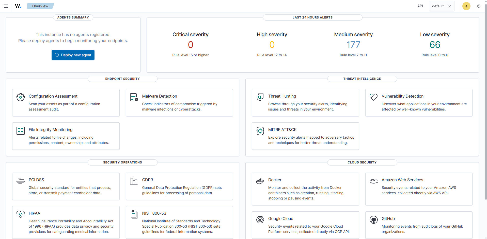
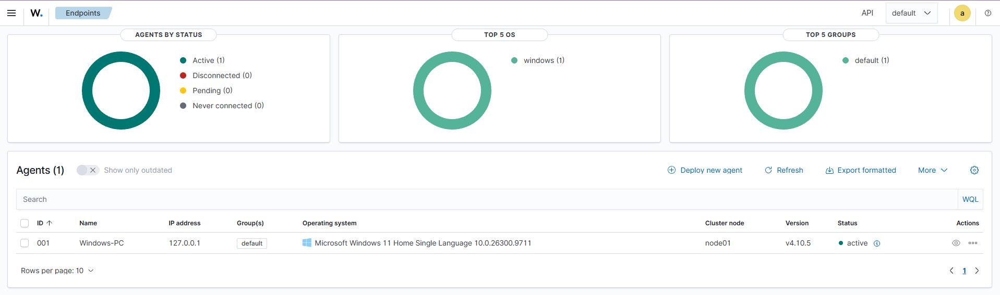
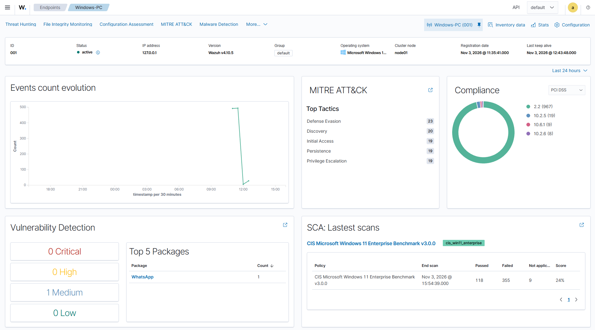
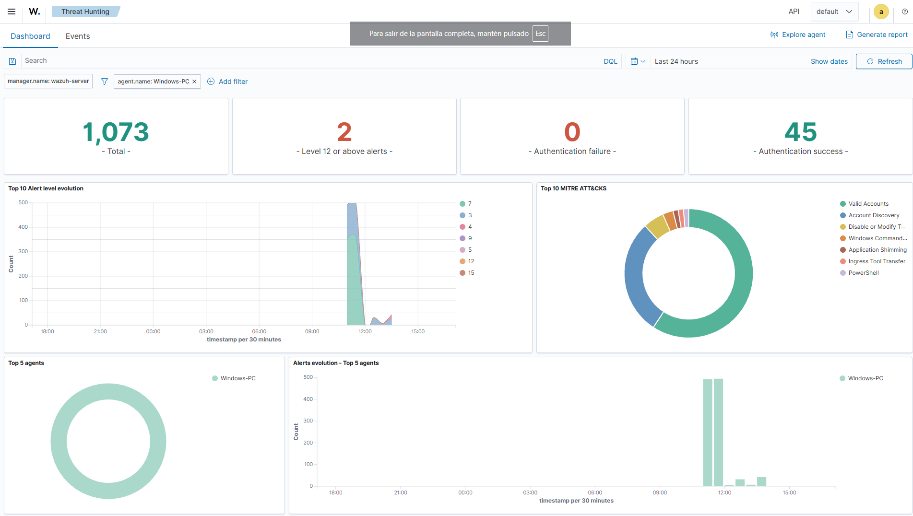
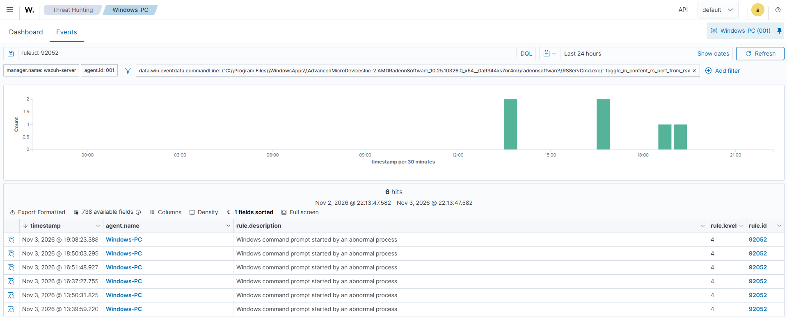
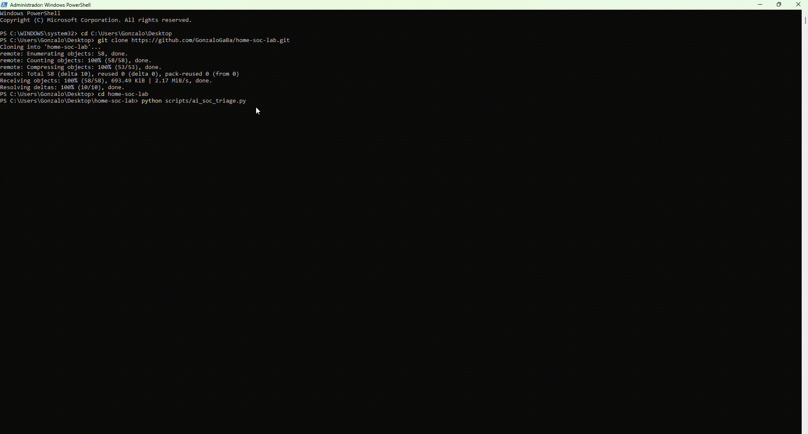

# 🛡️ Home SOC Lab: Wazuh SIEM Deployment & Endpoint Telemetry (Sysmon)

## 📌 Overview
Este proyecto documenta la construcción de un entorno de **Security Operations Center (SOC) casero** utilizando la plataforma SIEM/XDR **Wazuh**. El laboratorio simula la monitorización de endpoints, recolección de eventos de seguridad y análisis avanzado de telemetría de amenazas bajo un enfoque defensivo (Blue Team).

---

## 🏗️ Architecture & Topology
* **Wazuh Manager:** Ubuntu Server (VirtualBox VM) — Configurado con NAT y reenvío de puertos (*Port Forwarding* para puertos `8443`, `1514`, `1515`).
* **Endpoint Monitoreado:** Windows 11 Home — Nombre de Agente: `Windows-PC` (ID: `001`).

---

## 🚀 Phase 1: Server Deployment & Clean Agent Onboarding
- Se desplegó el servidor central y se verificó el Dashboard principal.
- Se instaló y vinculó el agente de Wazuh en el sistema Windows mediante PowerShell apuntando al manager local.

### 1. Initial Dashboard State

### 2. Active Agent Verification (Windows-PC)

---

## 🔍 Phase 2: Sysmon Integration & Telemetry Collection
- Se instaló y actualizó **Sysmon (System Monitor)** utilizando la configuración de SwiftOnSecurity optimizada para el marco MITRE ATT&CK.
- Se modificó el archivo de configuración del agente (`ossec.conf`) para incorporar la lectura del canal operacional de Sysmon (`Microsoft-Windows-Sysmon/Operational`).

### Sysmon Telemetry Flow & Threat Mapping

---

## ⚡ Phase 3: Attack Simulation & Threat Detection (MITRE ATT&CK)
Para validar la efectividad de la telemetría de Sysmon integrada en Wazuh, se simuló una fase de **Reconocimiento y Descubrimiento** ejecutando comandos nativos de Windows en el endpoint:

- Enumeración de cuentas: `net user`
- Recopilación de info del sistema: `systeminfo`
- Auditoría de tareas programadas: `schtasks /query /fo LIST`

### Dashboard Alert & MITRE Mapping Verification

### Filtered Events Audit (Rule 92052)

---

## 🔍 Phase 4: Custom Detection Rule & AI Triage Copilot

### 1. Custom Rules & Detection Engineering
Se diseñaron reglas de detección personalizadas para elevar la severidad ante actividades de reconocimiento:
- **Tácticas MITRE ATT&CK:** Discovery (T1087 - Account Discovery, T1082 - System Information Discovery)
- **Nivel de Severidad:** Level 8
- **Regla Sigma (YAML):** [`rules/detect-recon-discovery.yml`](rules/detect-recon-discovery.yml)
- **Regla Nativa Wazuh (XML):** [`rules/local_rules.xml`](rules/local_rules.xml)

### 2. AI SOC Triage Integration (SOC Copilot)
Se implementó un script de automatización en Python ([`scripts/ai_soc_triage.py`](scripts/ai_soc_triage.py)) para procesar los eventos de seguridad en tiempo real y generar resúmenes ejecutivos con recomendaciones para analistas L1.

#### 🎬 Demostración de Ejecución en Vivo

