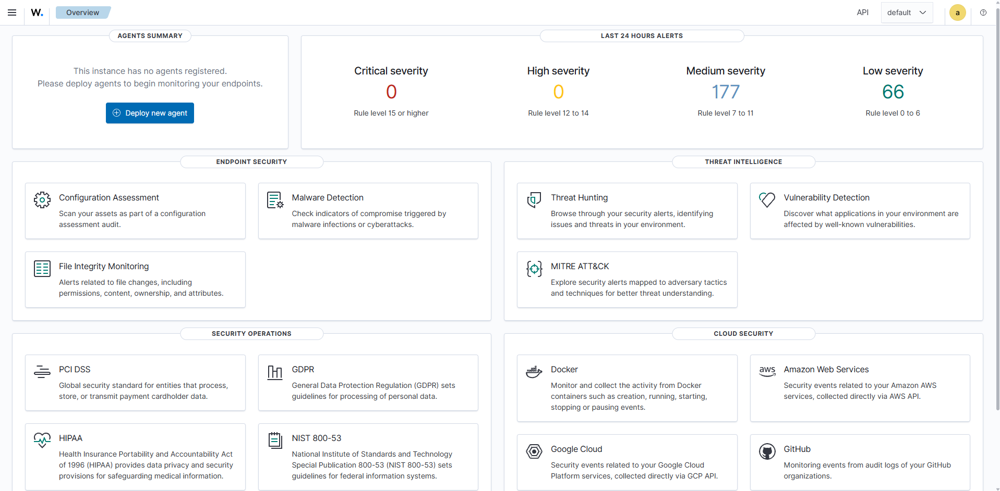
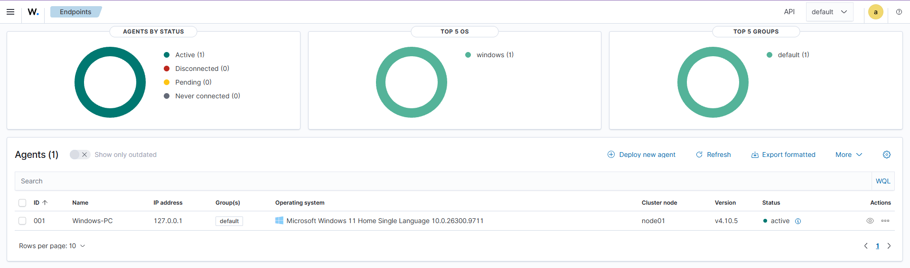
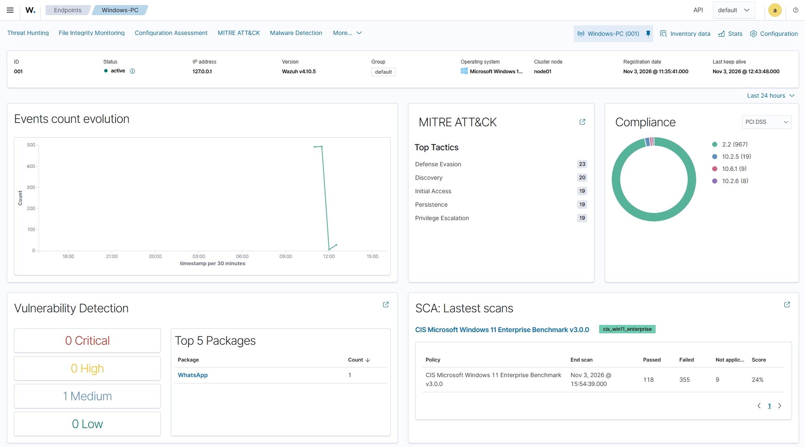
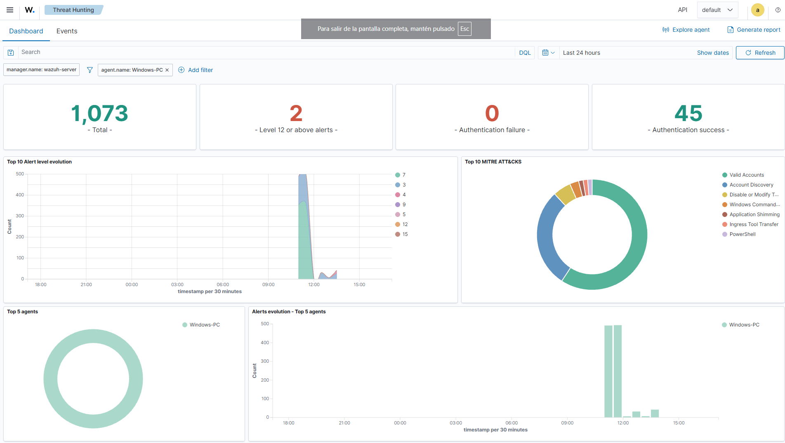
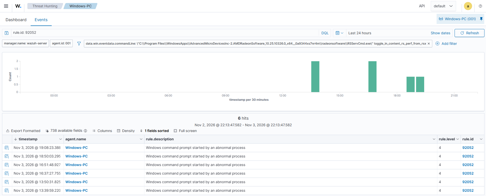
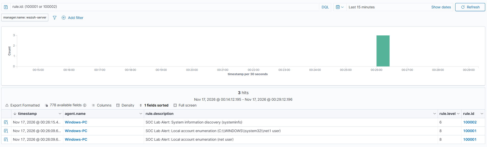

# Home SOC Lab: Wazuh + Sysmon, detección y triaje de alertas

> **English summary**
> - Home SOC lab: a Wazuh 4.10.5 manager (Ubuntu VM in VirtualBox) monitoring a Windows 11 endpoint with Sysmon.
> - Two custom detection rules for discovery activity (`net user` → T1087.001, `systeminfo` → T1082), plus Sigma equivalents checked with sigma-cli.
> - False-positive tuning: the Wazuh agent's own configuration checks triggered rule 100001; two exclusion rules fix it, and legitimate detections were re-tested afterwards.
> - A stdlib-only Python triage script reads real Wazuh alerts and applies explicit rules; an optional LLM layer adds a summary but **never changes the verdict**. 15 unit tests.
> - Limits: one endpoint, per-event rules (no correlation), and the LLM layer is only tested with mocked responses.

Laboratorio personal de **Blue Team / SOC nivel 1**: un servidor Wazuh monitorea un endpoint Windows con Sysmon. El foco del proyecto es el ciclo completo de ingeniería de detección: detectar, medir los falsos positivos, ajustar y volver a verificar.

Proyecto relacionado: [`soc-home-lab`](https://github.com/GonzaloGaBa/soc-home-lab) (Sysmon, regla Sigma y reporte de un incidente simulado).

## Qué demuestra este proyecto

- Despliegue de un SIEM/XDR (Wazuh) y onboarding de un agente Windows con telemetría de Sysmon.
- Escritura de reglas de detección propias en Wazuh (XML) y su equivalente en Sigma (YAML).
- **Ajuste de falsos positivos con evidencia**: encontré la causa, la corregí y comprobé que no se perdían detecciones legítimas (ver el caso de estudio más abajo).
- Un script de triaje con decisiones explícitas y reproducibles, con tests.
- Uso responsable de IA: opcional, sin autoridad sobre el veredicto, con datos sanitizados y salida validada.

## Arquitectura

| Componente | Detalle |
|---|---|
| Wazuh (manager, indexer, dashboard) | v4.10.5 en una VM Ubuntu Server (VirtualBox, red NAT) |
| Reenvío de puertos (host → VM) | `8443→443` (dashboard), `1514` (agentes), `1515` (registro), `2222→22` (SSH) |
| Endpoint | Windows 11 Home, agente `Windows-PC` (ID `001`) conectado a `127.0.0.1:1514` |
| Telemetría | Sysmon con la configuración de [SwiftOnSecurity](https://github.com/SwiftOnSecurity/sysmon-config) |

El agente lee el canal de Sysmon con este bloque en su `ossec.conf`:

```xml
<localfile>
  <location>Microsoft-Windows-Sysmon/Operational</location>
  <log_format>eventchannel</log_format>
</localfile>
```

## Estructura del repositorio

```
rules/      local_rules.xml (reglas Wazuh) y reglas Sigma (.yml)
scripts/    soc_triage.py (triaje de alertas)
tests/      test_soc_triage.py (15 tests)
examples/   sample-alerts.json (alertas reales del laboratorio, sanitizadas) y un reporte de ejemplo
images/     capturas del laboratorio
```

## Cómo reproducirlo

1. Instalá Wazuh en la VM siguiendo la [guía oficial (Quickstart)](https://documentation.wazuh.com/current/quickstart.html) y registrá el agente Windows con el asistente *Deploy new agent* del dashboard. Como la VM usa NAT con reenvío de puertos, el agente apunta a `127.0.0.1`.
2. Instalá Sysmon con la configuración de SwiftOnSecurity y agregá el bloque `localfile` de arriba al `ossec.conf` del agente.
3. Copiá las reglas al manager y verificá la sintaxis antes de reiniciar:

```bash
sudo cp rules/local_rules.xml /var/ossec/etc/rules/local_rules.xml
sudo chown wazuh:wazuh /var/ossec/etc/rules/local_rules.xml && sudo chmod 660 /var/ossec/etc/rules/local_rules.xml
sudo /var/ossec/bin/wazuh-analysisd -t && sudo systemctl restart wazuh-manager
```

   En una VM con pocos recursos el manager puede tardar varios minutos en arrancar; si systemd lo corta por tiempo, aumentá `TimeoutStartSec` con un *override* del servicio.
4. En el endpoint ejecutá `net user` y `systeminfo` en un `cmd` normal y mirá las alertas con `rule.id: (100001 OR 100002)` en el dashboard.

## Reglas

| ID | Nivel | Técnica MITRE | Qué detecta |
|---|---|---|---|
| 100001 | 8 | T1087.001 | `net user` / `net1 user` (enumeración de cuentas locales). Se apoya en la regla 92031 de Wazuh. |
| 100002 | 6 | T1082 | `systeminfo.exe`, por su nombre interno `sysinfo.exe` (detecta también si el ejecutable se renombra). |
| 100003 | 0 | n/a | Exclusión: `net.exe` lanzado por `wazuh-agent.exe` como SYSTEM. |
| 100004 | 0 | n/a | Exclusión: `net1.exe` hijo de ese `net.exe`, como SYSTEM y desde el directorio del agente. |

Equivalentes en Sigma (`rules/*.yml`): `detect-net-user-account-discovery.yml` (con los filtros del agente) y `detect-systeminfo-system-discovery.yml`.

## Caso de estudio: ajuste de falsos positivos

**Síntoma.** Con la regla 100001 recién creada, las alertas no solo aparecían por mis comandos: llegaban solas cada vez que arrancaba el agente.

**Causa.** Las alertas venían del propio agente. Al iniciar, el agente ejecuta chequeos de configuración (SCA) como `net user guest` y `net user administrator`, con el usuario SYSTEM y `wazuh-agent.exe` como proceso padre. Cada comando genera además un segundo evento (`net1.exe`, hijo de `net.exe`), así que una ronda producía 4 alertas (2 comandos × 2 procesos).

**Primer intento (falló).** Excluí por proceso padre, pero seguían apareciendo alertas. Probando contra los eventos reales vi que Wazuh guarda las rutas de Windows con las **barras invertidas duplicadas** (`C:\\Windows\\System32\\net.exe`), y mis expresiones esperaban una sola. Además, el `net.exe` del agente (que es de 32 bits) vive en `SysWOW64`.

**Solución.** Las reglas 100003 y 100004 usan `\\+` (una o más barras) y aceptan `System32` y `SysWOW64`.

**Verificación.**
- En el endpoint, Sysmon registró que el agente volvió a ejecutar `net user guest` y `net user administrator` al reiniciarse, y el manager **no generó ninguna alerta nueva**.
- Mis propios `net  user` y `systeminfo` siguieron alertando (prueba de regresión).

Este mismo comando muestra, en PowerShell como administrador, los procesos que lanzó el agente:

```powershell
Get-WinEvent -FilterHashtable @{LogName='Microsoft-Windows-Sysmon/Operational';Id=1;StartTime=(Get-Date).AddMinutes(-10)} |
  Where-Object {$_.Message -match 'ParentImage:.*wazuh-agent\.exe'} |
  ForEach-Object { [pscustomobject]@{Hora=$_.TimeCreated; Cmd=([regex]::Match($_.Message,'CommandLine: (.*)')).Groups[1].Value} } |
  Where-Object {$_.Cmd -match '^net'}
```

**Riesgo asumido.** Las exclusiones se basan en la ruta del agente y en el usuario SYSTEM: un atacante con privilegios de SYSTEM que lance `net user` desde ese directorio no generaría alerta.

## Script de triaje (`scripts/soc_triage.py`)

Lee un `alerts.json` de Wazuh (una alerta por línea), agrupa los eventos de una misma cadena (`net.exe` → `net1.exe`) y genera un reporte en Markdown. Solo usa la librería estándar de Python (3.8 o superior).

```bash
python scripts/soc_triage.py --input examples/sample-alerts.json --output reporte.md
# en el manager, sobre las alertas reales:
sudo python3 scripts/soc_triage.py --input /var/ossec/logs/alerts/alerts.json --last 50
```

El veredicto lo deciden **reglas explícitas**, no un modelo:

| Veredicto | Cuándo |
|---|---|
| Probable falso positivo | Padre `wazuh-agent.exe` y usuario SYSTEM |
| Escalar | Padre inusual (Office, `wscript`, `mshta`, `rundll32`, `wmiprvse`…) |
| Requiere verificación | Ejecución interactiva (`cmd`, `powershell`, `explorer`…) por un usuario |
| Cadena incompleta | Falta el evento padre en las alertas analizadas |
| Sin clasificar | No coincide con ningún patrón conocido |

El reporte incluye la hora real del evento (`utcTime`) en UTC y en hora argentina, y avisa si el reloj del manager está desfasado. Ejemplo completo: [`examples/reporte-ejemplo.md`](examples/reporte-ejemplo.md), generado con [`examples/sample-alerts.json`](examples/sample-alerts.json) (alertas reales del laboratorio, con el nombre de la PC reemplazado por `LAB-PC`).

### Capa de IA opcional (`--ai`)

```bash
python scripts/soc_triage.py --input examples/sample-alerts.json --ai mock        # sin clave, respuestas simuladas
ANTHROPIC_API_KEY=... python scripts/soc_triage.py --input alerts.json --ai anthropic   # modelo real
```

- **No decide**: agrega un resumen, hipótesis y verificaciones, y marca con una advertencia si discrepa de las reglas. El veredicto no cambia.
- **Datos mínimos y sanitizados**: no se envía hostname, usuario ni IPs.
- **Entrada no confiable**: la línea de comandos la controla quien ejecutó el proceso, así que viaja como dato dentro de `<evidence>` y el prompt indica ignorar instrucciones allí.
- **Salida validada** (estructura y largo) y mostrada como texto plano.
- Si falla o falta la clave, el reporte se genera igual. La clave se lee **solo** de la variable de entorno `ANTHROPIC_API_KEY`.

> **Estado honesto:** esta capa está implementada y probada con respuestas **simuladas**. No fue evaluada con un modelo real.

### Tests

```bash
python tests/test_soc_triage.py
```

15 tests con eventos sintéticos, sin red ni claves: veredictos, agrupación de cadenas, sanitización, respuestas malformadas de la IA y que la IA no pueda cambiar el veredicto. Uno de los tests detectó una fuga real durante el desarrollo: el motivo del veredicto incluía el usuario y se habría enviado al modelo.

## Evidencia

| Captura | Qué muestra |
|---|---|
|  | Estado inicial del dashboard, sin agentes registrados. |
|  | Agente `Windows-PC` (ID 001), versión 4.10.5, activo. |
|  | Vista del agente: eventos, tácticas MITRE ATT&CK y evaluación de configuración (SCA). |
|  | Panel de Threat Hunting del agente (últimas 24 h). |
|  | Regla por defecto 92052 disparada por actividad de software de AMD Radeon, no por mis comandos: ejemplo de ruido de reglas genéricas (probablemente benigno). |
|  | Mis reglas 100001 y 100002 alertando al ejecutar `net user` y `systeminfo` (captura **anterior** al ajuste de falsos positivos). |

## Limitaciones

- Un solo endpoint Windows en un laboratorio doméstico; no es un entorno de producción.
- Las reglas evalúan cada evento por separado (sin correlación de secuencias) y la 100001 depende de la regla 92031 de Wazuh.
- No cubren `schtasks`, `whoami`, `tasklist` ni otras variantes de descubrimiento.
- Las exclusiones asumen la ruta del agente y el usuario SYSTEM (riesgo descrito arriba).
- Las reglas Sigma se validaron con `sigma check`; no las convertí ni ejecuté contra un SIEM.
- El triaje es heurístico (listas fijas, sin inteligencia de amenazas) y el reporte usa la zona horaria de Argentina.
- La capa de IA solo se probó con respuestas simuladas.

## Nota sobre el historial

Las primeras versiones de este repositorio presentaban un "AI SOC Copilot". En realidad era una plantilla que mostraba un evento fijo escrito a mano, sin IA ni lectura de alertas reales. Lo reemplacé por el triaje actual y lo dejo documentado acá para que el historial no genere confusión.
